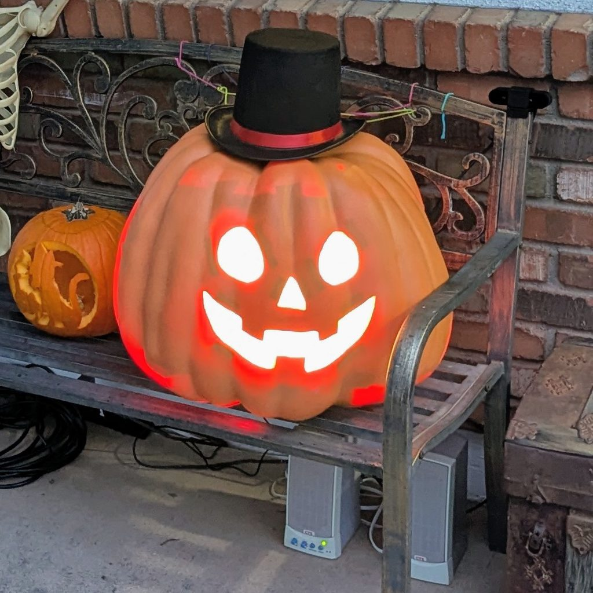
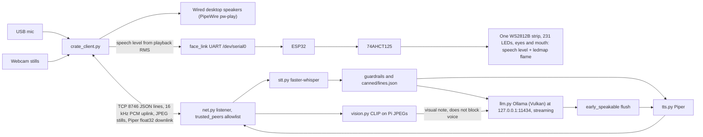

# Gourdsworth



Mayor Gourdsworth of Pumpkinville greets trick-or-treaters on the porch. Halloween 2026 was its first live night.

The Raspberry Pi 4 handles only the mic, wired desktop speakers on the Pi, the camera, and the face. The face is a UART link to an ESP32 that drives one LED strip lighting both the eyes and the mouth. Speech sets the brightness from the reply audio, and between replies the strip runs a flame animation shaped by the LED placement map ([hardware/ledmap231.json](hardware/ledmap231.json), turned into `firmware/esp32/src/led_height.h` by [tools/ledmap_to_header.py](tools/ledmap_to_header.py)). All inference (STT, LLM, TTS, vision) runs locally on the Framework Desktop. No cloud. Audio and stills stay in RAM, and nothing leaves the house.

## Halloween 2026 live night

The desktop server log for the night, after the last server start, records 132 turns. 131 used the streaming early-TTS path. 1 was a canned line. The table is all 132 turns.

`first_syllable` is the silence after the kid stops talking until the first Mayor audio.

| | median | p90 |
| --- | ---: | ---: |
| first_syllable | 1634 ms | 2619 ms |
| stt | 214 ms | 317 ms |
| llm_ttft | 250 ms | 294 ms |
| tts_first | 182 ms | 269 ms |

Models on that start: faster-whisper `base.en`, Ollama `llama3.1:8b` on the Vulkan backend, Piper `en_US-danny-low`, CLIP ViT-B-32 costume hints, and an optional YOLOv8n person count.

The live night ran VAD mode on the LAN with vision on, unlike the `config.example.yaml` defaults (push-to-talk, loopback, vision off).

## Turn path



The Pi client is `clients/pi/crate_client.py`. The desktop command is `python -m gourdsworth --serve-crate --vision`. CLIP may attach a visual note when the LLM starts. Voice keeps going while CLIP runs. See [ARCHITECTURE.md](ARCHITECTURE.md) and [firmware/esp32/README.md](firmware/esp32/README.md).

## Hardware (BOM)

Summary from [hardware/BOM.md](hardware/BOM.md) and the other hardware docs. Full parts list and the wiring diagram: [hardware/BOM.md](hardware/BOM.md), [hardware/wiring.svg](hardware/wiring.svg), [hardware/README.md](hardware/README.md).

LED 5 V and the Pi USB-C supply stay on separate rails. Grounds meet at one star point.

| Part | Role |
| --- | --- |
| Framework Desktop (AMD Ryzen AI Max / Strix Halo) | Inference host |
| Raspberry Pi 4 | Mic, speaker, camera, face UART |
| ESP32 DevKit V1, WROOM-32, 30-pin | UART from the Pi; drives the LEDs |
| 74AHCT125 | Level shifter, LED data |
| [BTF-LIGHTING WS2812B IC RGB LED Strip, UL listed, DC 5 V, 16.4 ft, 300 LEDs, IP30 (60 LEDs/m)](https://a.co/d/03Zu0j3C) | Whole face, eyes and mouth, on GPIO 18. 231 of the 300 LEDs are used |
| Mean Well LRS-150-5 | LED supply. BOM also lists LRS-150F-5 |
| Raspberry Pi 15 W USB-C supply | Pi only |
| Wired desktop speakers | Pi audio out |
| USB webcam and/or USB mic | Any generic USB webcam and/or mic works |
| [Hobby Lobby Orange Jumbo Pumpkin](https://www.hobbylobby.com/fall-thanksgiving/fall-thanksgiving-decorations/pumpkin-decor/orange-jumbo-pumpkin/p/81281996) | Shell, 22" W x 19" H |

## Setup and run

```bash
git clone git@github.com:PixnBits/gourdsworth.git
cd gourdsworth
python3 -m venv .venv
source .venv/bin/activate
pip install -e .
pip install -e '.[vision]'
cp config.example.yaml config.yaml
ollama pull llama3.1:8b
```

Ollama must already be running on the desktop. Set `ollama.model` in `config.yaml` to the pulled name. If that name is not pulled, startup auto-selects the best already-pulled instruct model (prefers about 7–8B; 14B is accepted when that is the smallest). The example voice is Piper `en_US-danny-low`.

### GPU note / known issue

Ollama on the Framework Desktop runs the Vulkan backend with ROCm hidden. ROCm on gfx1151 produced garbled `llama3.1:8b` output with the full Mayor prompt. Set it in a `systemctl edit ollama` override:

```
[Service]
Environment=OLLAMA_VULKAN=1
Environment=OLLAMA_IGPU_ENABLE=1
Environment=HIP_VISIBLE_DEVICES=-1
Environment=ROCR_VISIBLE_DEVICES=-1
```

Desktop crate block. `192.0.2.55` is a documentation address for the Pi. Use the Pi's address.

```yaml
crate:
  host: 0.0.0.0
  port: 8746
  allow_lan: true
  trusted_peers: [192.0.2.55]
```

`trusted_peers` is an allowlist of IP addresses. Other addresses are closed at accept. Put only the Pi on the list. A second trusted address can replace the Pi and hold it in the 30 second backoff. Entries split on commas or whitespace. A CIDR, a hostname, or `*` exits 2, and the error names the bad entry. An IPv4-mapped address (`::ffff:a.b.c.d`) compares as IPv4. A non-loopback bind with an empty trusted list exits with code 2. A loopback bind with an empty list still starts. `CRATE_TRUSTED_PEERS` is read once at startup and merged with `crate.trusted_peers`.

Pin the Pi in the user unit:

```bash
systemctl --user edit gourdsworth-server
```

```
[Service]
Environment=CRATE_TRUSTED_PEERS=192.0.2.55
```

Run the desktop:

```bash
python -m gourdsworth --serve-crate --vision
```

On the Pi, see [clients/pi/README.md](clients/pi/README.md). `192.0.2.10` is a documentation address for the desktop.

```bash
PYTHONPATH=src python clients/pi/crate_client.py --host 192.0.2.10 --continuous
```

The user unit [clients/pi/systemd/gourdsworth-porch.service](clients/pi/systemd/gourdsworth-porch.service) runs `clients/pi/crate_client.py --continuous` and reads `clients/pi/local.env`. Copy that file from [clients/pi/local.env.example](clients/pi/local.env.example).

Protocol smoke, same machine, no Whisper, Ollama, or Piper:

```bash
python -m gourdsworth --crate-echo
PYTHONPATH=src python clients/pi/crate_client.py --host 127.0.0.1 --no-camera --no-mic
```

Enter is Talk and sends silence. The client plays a round trip.

`--dry-run` skips the mic and speaker playback. Type a kid line and the process still reports LLM and TTS timing. Startup still preloads Whisper, warms Ollama, and loads Piper.

```bash
python -m gourdsworth --list-devices
python -m gourdsworth --dry-run
```

Every spoken turn prints a metrics line:

```
record=…ms  stt=…ms  llm_ttft=…ms  llm=…ms  tts_first=…ms  tts=…ms  play=…ms  first_syllable≈…ms  turn=…ms
```

A crate turn can also print `uplink_first`, `uplink_jitter`, `[early-tts]` or `[canned]`, and vision fields. `first_syllable` is the porch wait defined above.

### Privacy

Startup exits with code 2 if `save_audio` or `save_transcripts` is true. Ollama stays on `127.0.0.1:11434`. History is four turns of text, in process memory. Crate TCP has no TLS and no auth. With `allow_lan: true`, anyone on that network can read the PCM and the JPEGs. Keep the port on the porch LAN.

### Character

[prompts/mayor_system.txt](prompts/mayor_system.txt) is the personality. [canned/lines.json](canned/lines.json) covers silence, crowds, distress, and model failure.

### Logs

Both sides write under `logs/`, which is gitignored.

- Desktop `--serve-crate`: `logs/crate-desktop.log`
- Pi client: `logs/crate-pi.log` (override with `--log-file` or `CRATE_LOG`)

### Tests

```bash
python -m pytest -q
```

## Docs

- [ARCHITECTURE.md](ARCHITECTURE.md)
- [hardware/README.md](hardware/README.md)
- [firmware/esp32/README.md](firmware/esp32/README.md)
- [clients/pi/README.md](clients/pi/README.md)
